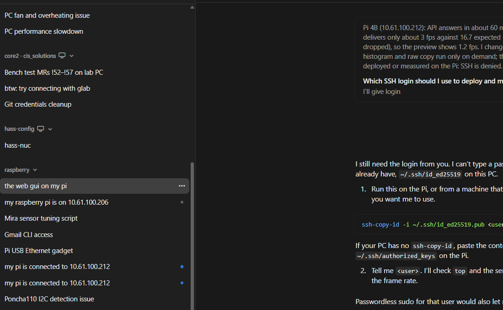
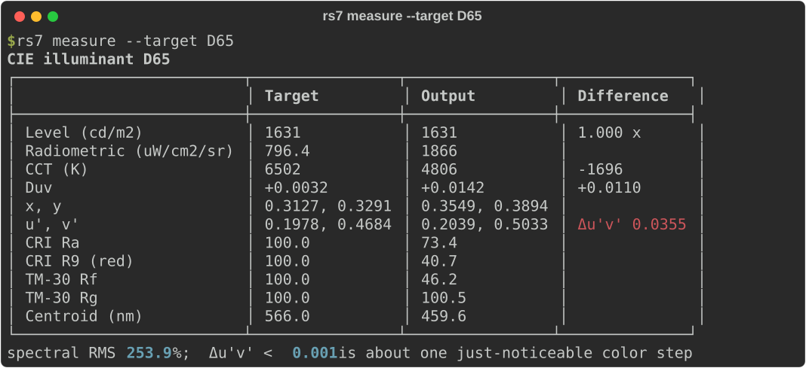

# gammascientific-rs7

Python API, command line tool and desktop GUI for the Gamma Scientific **SpectralLED RS-7** tunable light source.



*`rs7-gui` after matching CIE D65 at 500 cd/m2 with the local fit: output spectrum (white) over the D65 target
(blue), color quality (Δu'v' 0.0001, CRI 97, TM-30 Rf 97.5), CIE chart with the Planckian locus.*



*`rs7 measure --target D65`: the present output compared with D65 at the same level (read-only).*

- `rs7` (Python): a small API over the RS-7's ASCII command set (user manual, section 4)
- `rs7` (command): control the unit from a terminal (`rs7 set`, `rs7 match`, `rs7 spectrum`, ...)
- `rs7-gui`: a desktop window (PySide6) laid out like the manufacturer's SpectralLED Assistant
- `rs7 web`: the same controls in a browser (FastAPI, `web` extra), for a headless Raspberry Pi or any PC on the lab network ([docs/web.md](docs/web.md))
- **spectral matching**: make the RS-7 reproduce a CIE illuminant (D65, A, FL2, LED-B3, ...), a CIE daylight or black body at any temperature, or a spectrum from a CSV file, at an absolute level in lux or cd/m2. By default the channel powers are solved on the PC from the measured spectrum of each channel (bounded least squares with feedback from the real output); the RS-7's own fit is available with `--method firmware`
- **color quality**: CCT, Duv, xy, u'v', CRI (Ra, R1-R14) and TM-30 (Rf, Rg) of the output and of the target, and the difference between them, computed on the PC with [colour-science](https://www.colour-science.org/)
- **monochromatic steps and scans**: one narrow channel at a chosen photon flux, radiant power or drive level, or a scan through all narrow channels at equal photon flux (spectral response and QE measurements)
- **characterization**: output, color and wavelength shift against drive level (dimming), and a log of output, color and temperature over time (warm-up, drift)
- **camera color accuracy**: the RS-7 lights an X-Rite ColorChecker with a known spectrum and the package compares the colors a camera measures (raw frames from the `picam-web` service on a Raspberry Pi) with the colors the patches should have, as CIE ΔE2000 per patch, for several illuminants ([docs/camera.md](docs/camera.md))
- **snapshots**: save the channel powers and spectrum to a JSON file and restore them later; the GUI can also draw saved spectra or CSV files as references, and export the spectrum as CSV or the plot as PNG
- runs on Linux (including the Raspberry Pi) and Windows with Python 3.11 or newer; the CLI and API need `pyserial`, `typer`, `rich`, `scipy` and `colour-science` (numpy)

## Install

Download the installer for your platform from the [latest release](https://github.com/phili-b/gammascientific-rs7/releases/latest). They bundle Python, so nothing else is needed.

- **Windows:** `gammascientific-rs7-<version>-windows-x64-setup.exe` (Start Menu shortcut, optional PATH entry), or the portable zip.
- **Debian / Ubuntu / Raspberry Pi OS:** `sudo apt install ./gammascientific-rs7_<version>_<amd64|arm64>.deb`, then `rs7` and `rs7-gui`. Add yourself to the `dialout` group for serial access.
- **Other Linux:** the `.AppImage` starts the GUI; `./gammascientific-rs7-*.AppImage cli measure` runs the command line.
- **Python:** `pip install "gammascientific-rs7[gui]"` or `uv tool install "gammascientific-rs7[gui]"`.

Or install from source:

The project uses [uv](https://docs.astral.sh/uv/). CLI and GUI:

    uv tool install "gammascientific-rs7[gui] @ git+https://gittf.ams-osram.info/cis_solutions/hardware/gammascientific-rs7.git"

CLI and Python API only (e.g. a headless Raspberry Pi), without PySide6:

    uv tool install "gammascientific-rs7 @ git+https://gittf.ams-osram.info/cis_solutions/hardware/gammascientific-rs7.git"

As a library in your own project:

    uv add "gammascientific-rs7 @ git+https://gittf.ams-osram.info/cis_solutions/hardware/gammascientific-rs7.git"

On Linux, add your user to the `dialout` group once (`sudo usermod -aG dialout $USER`, then log in again) to be allowed to use `/dev/ttyUSB0`.

## Quick start

`RS7()` without a port picks the first RS-7 it finds (the unit's FTDI FT232R USB-serial chip, USB ID 0403:6001) and raises `PortNotFoundError` if there is none. You can also pass a port such as `"/dev/ttyUSB0"`, `"COM5"` or `"socket://host:5000"`.

```python
from rs7 import RS7, Units

with RS7() as rs7:
    print(rs7.version(), rs7.temperatures())

    rs7.set_units(Units.INTERNAL)  # power numbers are now 0-100 %
    rs7.set_channel_power(5, 10)  # returns once the output has settled
    print(rs7.channel_powers())  # {channel: power} for channels that are on

    rs7.recall_preset(0)
    print(rs7.output(Units.PHOTOMETRIC), "lux", rs7.chromaticity(), rs7.cct(), "K")
```

Match a target spectrum and read the color quality ([docs/colorimetry.md](docs/colorimetry.md)):

```python
from rs7 import RS7
from rs7.match import match

with RS7() as rs7:
    result = match(rs7, "D65", level=500)  # lux (irradiance) or cd/m2 (radiance)
    out = result.output
    print(out.cct, out.duv, out.cri_ra, out.tm30_rf, result.comparison.delta_uv_prime)
```

`match` solves the channel powers on the PC (`method="local"`, the default; the first call on a unit measures every channel, about 10 s, and caches the result in `~/.rs7`). Use `method="firmware"` for the RS-7's own fit.

Step through the narrow channels at equal photon flux, and save and restore the state ([docs/tools.md](docs/tools.md)):

```python
from rs7 import RS7
from rs7.mono import mono_scan
from rs7.snapshot import Snapshot, restore, take

with RS7() as rs7:
    for step in mono_scan(rs7, 400, 1000, photons=1e13):  # photons/s/cm2 (or /sr); the unit is restored afterwards
        print(step.centroid_nm, step.power, step.photon_flux)  # take your measurement here

    take(rs7, note="before").save("state.json")
    # ... change the unit ...
    restore(rs7, Snapshot.load("state.json"))
```

## Command line

```
rs7 ports                    # list serial ports, the RS-7 is marked
rs7 info                     # firmware, temperatures, alarm, output, color
rs7 channels                 # channels that are on, with wavelength and power
rs7 set 5=10 --only          # channel 5 to 10 %, all other channels off
rs7 preset load 0            # load preset 0
rs7 output 100 --keep-color  # 100 lux, keeping the chromaticity
rs7 illuminants              # the target spectra that match accepts, with CCT, Duv, xy, CRI
rs7 match D65 --level 500    # reproduce D65 at 500 lux (cd/m2) and report the match (local fit)
rs7 match D65 -l 500 -m firmware  # the same with the RS-7's own fit
rs7 match 3000K --max        # imitate a 3000 K black body at the highest output
rs7 measure --target D65     # color quality of the present output, compared with D65 (changes nothing)
rs7 spectrum --csv out.csv   # write the output spectrum to a file
rs7 basis                    # the per-channel spectra of the local fit (measured once, then cached)
rs7 mono 550 --photons 1e13  # only the narrow channel nearest 550 nm, at 1e13 photons/s/cm2
rs7 scan --start 400 --end 700 --photons 1e13 --csv scan.csv  # every narrow channel in turn, equal flux
rs7 dimming --channel 4      # how channel 4 changes (power, wavelength, width) with drive level
rs7 monitor --interval 10 --duration 600 --csv log.csv       # output, color, temperature over time
rs7 camera                   # the camera on the Raspberry Pi: model, mode, exposure, gain, black level (read-only)
rs7 chart --png chart.png    # check where the ColorChecker is: overlay image and R, G, B of each patch (read-only)
rs7 colorcheck --illuminants D65,A  # camera color accuracy (ΔE2000) under D65 and A; changes the light, restores it
rs7 save state.json          # save the channel powers and spectrum
rs7 restore state.json       # put the unit back
rs7 off
```

Without `--port` / `-p` (or the `RS7_PORT` environment variable) the first RS-7 found is used. `rs7 --help` lists all commands; they are described in [docs/cli.md](docs/cli.md); the spectral matching and the color metrics are explained in [docs/colorimetry.md](docs/colorimetry.md), the monochromatic scans, dimming, monitoring and snapshots in [docs/tools.md](docs/tools.md), and the camera color accuracy in [docs/camera.md](docs/camera.md). `rs7 bridge` shares the unit over TCP so another machine can use it.

## GUI

    rs7-gui

or `rs7 gui` or `python -m rs7.gui`. Pick a port under **Settings > Select COM Port**; it is remembered, and if none is stored the first RS-7 found is used. All unit communication runs on a background thread, so the window does not freeze. A **Color quality** panel shows CCT, Duv, CRI and TM-30 of the output; **View > Target Spectrum** matches a target spectrum (**Fit with** the local optimizer or the RS-7 firmware); the **File** menu saves and restores snapshots, saves the spectrum as CSV, exports the plot as PNG and adds reference spectra to the plot. See [docs/gui.md](docs/gui.md).

## Web interface

    rs7 web                                          # unit on this machine (first RS-7 found), http://<this machine>:8000
    rs7 web --device socket://10.61.100.206:5000     # unit shared by `rs7 bridge` on another machine

Needs the `web` extra (`uv tool install "gammascientific-rs7[web] @ git+https://gittf.ams-osram.info/cis_solutions/hardware/gammascientific-rs7.git"`). Channel sliders, spectrum, presets, target match and color quality in a browser, also on a phone. There is no login: use it on a trusted network only. See [docs/web.md](docs/web.md).

## Documentation

- [Getting started](docs/index.md)
- [Command line](docs/cli.md)
- [Spectral matching and color quality](docs/colorimetry.md)
- [Spectral tools](docs/tools.md): monochromatic scans, dimming, monitoring, snapshots
- [Camera color accuracy](docs/camera.md): ColorChecker, color matrix, ΔE2000
- [API reference](docs/api.md)
- [GUI](docs/gui.md)
- [Web interface](docs/web.md)
- [Serial protocol notes](docs/protocol.md)
- [Examples](examples/)

Serve the HTML docs locally with `uv run --group docs mkdocs serve`.

## Releasing

Bump `version` in `pyproject.toml` and `src/rs7/__init__.py`, merge, then `git tag v<version> && git push origin v<version>`. The Release workflow builds the wheel, the Windows installer, and the Linux AppImage and .deb (x86_64 and aarch64), creates the GitHub release, and publishes to PyPI.

## Development

    uv sync
    uv run pytest
    uv run ruff check
    uv run ruff format
    uv run ty check

The tests use a fake serial port, so no hardware is needed. The dev tools (pytest, ruff, ty, and PySide6 so the GUI is tested and type-checked) are in the `dev` dependency group, which `uv sync` installs by default. Tested on Windows 11 and Raspberry Pi OS (aarch64).
