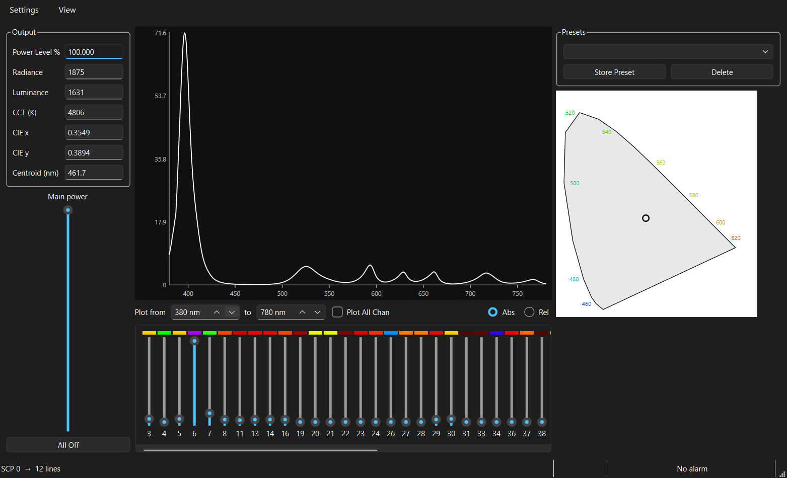

# GUI

The GUI is built with PySide6 and is an optional part of the package (the `gui` extra, see
[Getting started](index.md#install)). Start it with `rs7-gui`, `rs7 gui` or `python -m rs7.gui`.
The layout follows the manufacturer's SpectralLED Assistant (user manual, section 3); the numbers in brackets are the manual's labels.

| Area | What it does |
|---|---|
| Output pane (1a) | Power level %, radiance/irradiance, luminance/illuminance, CCT, CIE x, y, centroid. Type a value and press Enter to set it. **Shift+Enter** on a power value keeps the chromaticity. |
| Main power (1b) | Drag to scale the whole spectrum; hold **Shift** to keep the chromaticity. |
| Channel sliders (1c) | One per fitted channel, with its color on top; hover to see its wavelength in the status bar. Scroll sideways for more channels. Sliders only send a value when you move them, never when the program updates them. |
| Abs / Rel (1d) | Show channel powers as absolute %, or relative to the strongest channel. |
| All Off (1e) | Switch every channel off. |
| Spectral plot (1f-1h) | Output spectrum (white); **Plot All Chan** adds each channel in its color; set the plotted range under the plot. |
| CIE 1931 chart (1i) | The circle is the present chromaticity; click anywhere to move the color there. |
| Status bar (1j) | Last command and reply; flashes red on an error. Shows "working..." while the unit is busy. |
| Presets (1k) | Pick one in the combo box to load it; **Store Preset** saves the present output; **Delete** deletes the selected one. |
| Alarm box (1m) | Polled every 2 s; red while an alarm is active; click to clear. |

## Settings menu

- **Select COM Port**: connect; the port is remembered (Qt `QSettings`) and reused at the next start. If none is stored, the first RS-7 found is used.
- **Network Address**: connect to a port shared with `rs7 bridge` (`socket://host:5000`).
- **Standard Observer** (2 or 10 degrees), **Peak Type**, **Optical Feedback**, **Working Distance**.
- **Include White Channels in Spectral Fit**.

## Target spectrum (View > Target Spectrum)

Replaces the CIE chart with the target pane (manual 3.3); the target is drawn in blue on the plot.

- **Load CSV**: `wavelength, amplitude` per line, any step size (interpolated to 1 nm).
- **Black body CCT**: type a temperature and press Enter.
- **Scale factor**: multiplies the target.
- **Fit range**: wavelengths used for the fit.
- **Fit To Target** / **Fit At Max**, with optional **Correct chromaticity after fit**; the RMS error is shown.

## Not (yet) in this GUI

Offline mode with a calibration file, the CIE illuminant and ColorChecker libraries, export to CSV,
accessory transfer functions and the iris. All of these can still be reached with `RS7.command()`
(the CLI can export a spectrum: `rs7 spectrum --csv`).

## Threading

All communication with the unit runs on a background worker thread, so the window does not freeze while the
RS-7 settles. A "working..." indicator in the status bar shows while a command is in progress.
